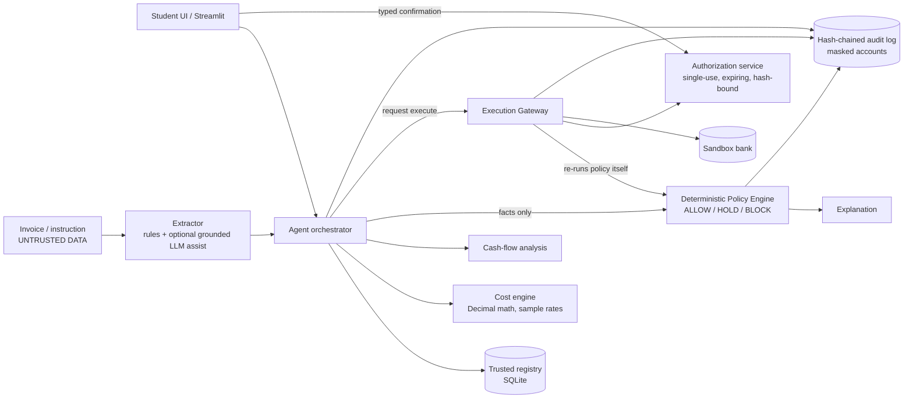

# Architecture (editable Mermaid source - paste into mermaid.live to render/export)

Trust boundary: everything left of the Policy Engine may be influenced by documents or an AI model; the Policy Engine, Authorization service, Gateway and Sandbox bank are plain deterministic code and never read model output as authority.
